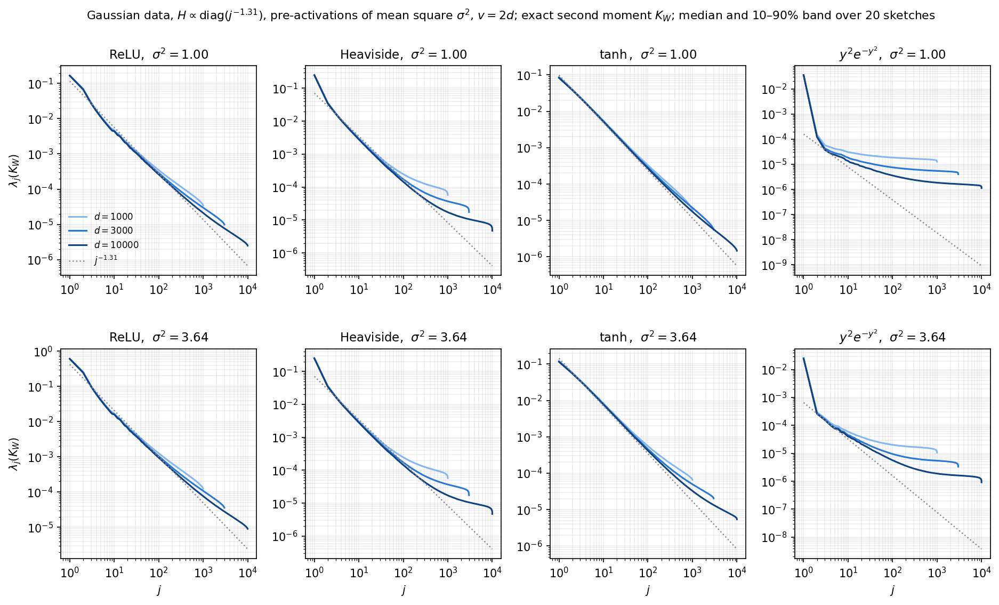
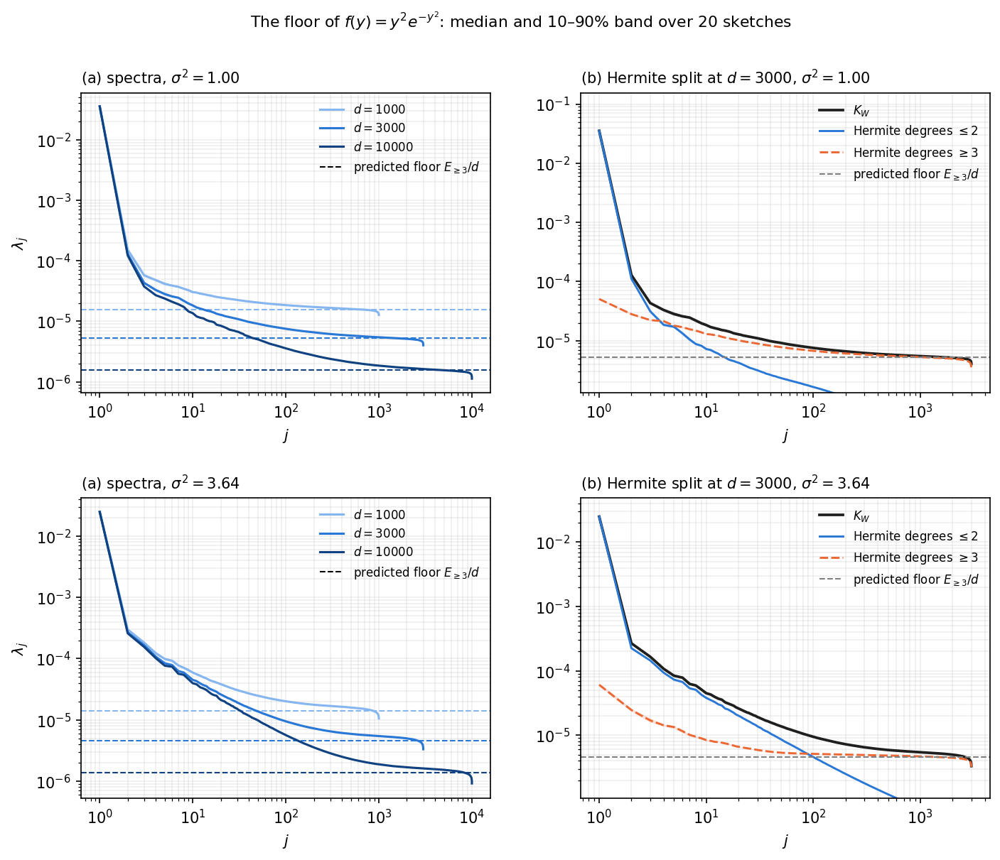

# Other activations: ReLU, Heaviside, $$\tanh$$, $$y^2e^{-y^2}$$

*In the paper: Figure 2 (right), the paragraph "Beyond polynomial activations" in Section 2.1, and the
paragraph "Scope and limitations". Code:
[`experiments/fig2_activations/`]({{ site.repo_url }}/tree/main/experiments/fig2_activations), with
`plrf/gaussian.py`.*

**Question.** The main theorem covers polynomial activations. Do the activations used in practice also
give power-law spectra? And what happens with $$y^2e^{-y^2}$$, whose spectrum is far from a power law at
these sizes?
{: .lead}

**Answer.** ReLU and $$\tanh$$ give clean power laws close to $$j^{-\alpha}$$, and Heaviside gives a power
law followed by a flat stretch. $$y^2e^{-y^2}$$ gives one large eigenvalue followed by an almost flat
spectrum. The flat parts are not a different exponent. They are a *floor*, whose height is proportional
to $$1/d$$ and is predicted, with no fitting, by how much of the activation's variance lies in high
Hermite degrees. [Below](#the-floor-of-y2e-y2) this is checked in detail for $$y^2e^{-y^2}$$.
{: .lead}



**Figure 1.** Gaussian data with $$H \propto \operatorname{diag}(j^{-1.31})$$, scaled so that the
pre-activations $$y_i = w_i^\top x$$ have mean square $$\sigma^2$$; $$v = 2d$$. The exact spectrum of $$K_W$$
(no Monte Carlo) at $$d = 10^3$$, $$3\cdot10^3$$, $$10^4$$ (light to dark): median over 20 sketches with the
10–90% band. Dotted grey: $$j^{-1.31}$$, through the $$d = 10^4$$ curve at $$j = 3$$. Top row:
$$\sigma^2 = 1$$. Bottom row: $$\sigma^2 = 3.64$$, the scale of the first version of the paper's figure.
ReLU and Heaviside are homogeneous, so the scale only multiplies their spectra by a constant; it changes
the shape for $$\tanh$$ and $$y^2e^{-y^2}$$.
{: .caption}

## Setup

| | |
|---|---|
| Data | $$x \sim N(0, \sigma^2 H)$$, $$H = \operatorname{diag}(j^{-\alpha}) / \sum_k k^{-\alpha}$$, $$\alpha = 1.31$$, $$v = 2d$$; $$\sigma^2 \in \{1, 3.64\}$$ |
| Sketch | $$W \in \mathbb R^{v\times d}$$, i.i.d. $$N(0,1)$$; $$d \in \{10^3, 3\cdot10^3, 10^4\}$$ (`paper`), $$\{300, 1000\}$$ (`quick`) |
| Activations | ReLU, Heaviside $$\mathbf 1\{y > 0\}$$, $$\tanh$$, $$y^2 e^{-y^2}$$ |
| Matrix | the second moment $$K_W$$; the covariance is stored too |
| Computation | exact: closed forms for ReLU, Heaviside and $$y^2e^{-y^2}$$, and the Mehler (Hermite) series for $$\tanh$$ ([Methods](../methods.html#gaussian-inputs-the-hermite-expansion)) |
| Sketches | 20 per $$d$$ (`paper`), 3 (`quick`); the same $$W$$ for both scales |
| Seed | $$W$$ = `numpy.random.default_rng([2, d, draw]).standard_normal((v, d))` |

## Results

**ReLU and $$\tanh$$** follow $$j^{-\alpha}$$ closely. Both are dominated by their linear Hermite component:
it carries 50% of $$\mathbb E f^2$$ for ReLU and 85–93% for $$\tanh$$, and its spectrum is that of $$H$$. The
head of the spectrum does not change with $$d$$: from $$d = 3000$$ to $$d = 10^4$$ the eigenvalues up to
$$j = 100$$ change by at most 10%. Only the tail bends, near $$j \approx d$$, and the bend moves out as $$d$$
grows.

**Heaviside** follows a power law and then flattens. Its jump at 0 makes the Hermite coefficients decay
slowly, so 7.5% of its variance sits in degrees above 8. The flat stretch drops as $$d$$ grows, and the
power law extends further. This is the same floor as for $$y^2e^{-y^2}$$ below, on a smaller scale.

**$$y^2e^{-y^2}$$** has one large eigenvalue and then a nearly flat spectrum whose level drops as $$d$$
grows. The activation is even, with no linear Hermite component. 58–68% of its variance is its mean,
which gives $$\lambda_1$$. Little is in degree 2 (2% at $$\sigma^2 = 1$$, 10% at $$\sigma^2 = 3.64$$), and the
rest is spread over degrees 4 and higher. The next section shows that the flat part is a $$1/d$$ floor
made by those high degrees.

## The floor of $$y^2e^{-y^2}$$

**Why a floor.** By Mehler's formula ([Methods](../methods.html#gaussian-inputs-the-hermite-expansion)),
$$K_W$$ splits by Hermite degree:

$$
d\,(K_W)_{ij} = \sum_{k \ge 0} a_k(s_i)\, a_k(s_j)\, \rho_{ij}^{\,k},
$$

where $$\rho_{ij}$$ is the correlation of $$y_i$$ and $$y_j$$, and $$a_k(s)^2$$ is the part of
$$\mathbb E f(y)^2$$ carried by degree $$k$$ at variance $$s$$. Off the diagonal $$\lvert\rho_{ij}\rvert$$ is
typically about 0.2, so $$\rho_{ij}^{\,k}$$ is negligible once $$k$$ is moderately large. The high-degree
part of $$K_W$$ is then essentially diagonal:

$$
K^{(\ge 3)} = \sum_{k \ge 3} K^{(k)} \;\approx\; \tfrac1d\,\operatorname{diag}\Big(\textstyle\sum_{k\ge 3} a_k(s_i)^2\Big).
$$

A diagonal matrix with entries of comparable size has a flat spectrum, at height about
$$E_{\ge 3}/d$$, where $$E_{\ge 3}$$ is the average over neurons of $$\sum_{k \ge 3} a_k(s_i)^2$$. This is
white noise: it does not depend on $$H$$ and carries no power law. Its height falls like $$1/d$$, and
$$E_{\ge 3}$$ is computed directly from the Hermite coefficients, with no fitting.



**Figure 2.** $$f(y) = y^2e^{-y^2}$$; rows: $$\sigma^2 = 1$$ and $$\sigma^2 = 3.64$$. **(a)** The spectra of
Figure 1 again, with the predicted floor $$E_{\ge 3}/d$$ for each $$d$$ as a dashed line of the same color.
**(b)** At $$d = 3000$$: the spectrum of $$K_W$$ (black), and separately the spectra of its Hermite part of
degree $$\le 2$$ (blue) and of degree $$\ge 3$$ (orange, dashed). The two parts add up to $$K_W$$. Grey
dashed: $$E_{\ge 3}/d$$. Medians over 20 sketches with 10–90% bands.
{: .caption}

**What the figure shows.**

- In (a), the flat part of each spectrum sits on its predicted floor, and the floor drops by the factor
  by which $$d$$ grows. At $$\sigma^2 = 1$$, the measured level $$d\,\lambda_{d/2}$$ is 0.0161, 0.0158 and
  0.0156 at $$d = 10^3, 3\cdot10^3, 10^4$$, against the prediction $$E_{\ge 3} = 0.0157$$: within 2.5%. At
  $$\sigma^2 = 3.64$$ it is 10–15% above the prediction (0.0160 to 0.0153, against 0.0138). There the
  degree-2 part is larger, and the part of it that the sketch cannot resolve adds to the floor.
- In (b), the degree-$$\ge 3$$ part is nearly flat at the predicted height, as the argument says. It rises
  above it only over its first few dozen eigenvalues, where degrees 4 and 6 are still partly resolved. The degree-$$\le 2$$
  part carries the mean (the isolated $$\lambda_1$$) and a short decaying stretch. The spectrum of $$K_W$$
  follows the low-degree part where it is above the floor, and the floor where it is not.
- At $$\sigma^2 = 3.64$$ the degree-2 part is larger, so more of the decaying stretch is visible above the
  floor: at $$d = 10^4$$, $$\lambda_j$$ follows $$j^{-\alpha}$$ to within 25% for $$j \approx 2$$–$$10$$. At
  $$\sigma^2 = 1$$ only a few eigenvalues are above the floor.

**Conclusion.** The departure of $$y^2e^{-y^2}$$ from a power law at these sizes is this floor, so it is
not evidence of a different exponent. Equally, these sizes cannot show the exponent of $$y^2e^{-y^2}$$
over a long range. That would need $$d$$ large enough to push the floor below the structured part over
several decades of $$j$$.

**Relation to the paper's remark on analytic activations.** The paper remarks that summing the
logarithmic corrections of all Hermite degrees could change the decay for some analytic activations.
That is a statement about the population spectrum as $$j \to \infty$$, and this experiment neither
supports nor refutes it. What it shows is how the high Hermite degrees enter at accessible $$d$$: as a
$$1/d$$ white-noise floor, not through their logarithmic corrections.

## Reproduce

```bash
python -m experiments.fig2_activations.run   --config quick    # ~20 s on a laptop (numpy)
python -m experiments.fig2_activations.plot  --config quick
python -m experiments.fig2_activations.floor --config quick    # Figure 2
python -m experiments.fig2_activations.run   --config paper    # ~25 min on one GPU (torch, float64)
python -m experiments.fig2_activations.plot  --config paper
python -m experiments.fig2_activations.floor --config paper    # ~10 min on a laptop
python -m experiments.fig2_activations.summarize --config paper  # tables: convergence in d, Hermite energies
```

`run.py` writes `results/fig2_activations_<config>.npz`. Keys have the form
`<scale>__<activation>__d<d>__<K|C|le<L>|gt8|energy>`, with `<scale>` `unit` ($$\sigma^2 = 1$$) or `old`
($$\sigma^2 = 3.64$$). They hold the second moment, the covariance, Hermite partial sums and remainder
at $$d = 3000$$, and the Hermite energy by degree; arrays have shape (sketches, $$d$$). `floor.py` uses the
same sketches (same seeds), and writes `results/fig2_activations_floor_<config>.npz` and
`figures/fig2_activations_floor_<config>.{pdf,png}`.
