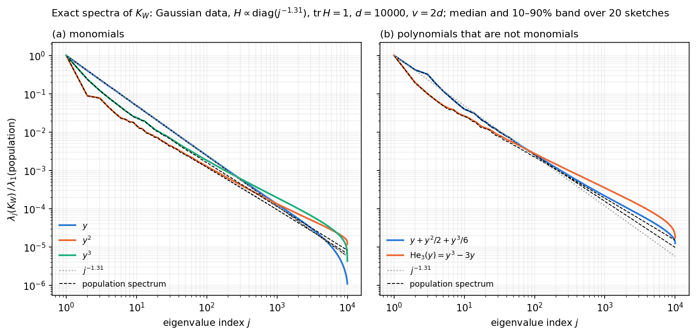

# The main theorem: the random-feature spectrum tracks the population spectrum

*In the paper: Figure 2 (left) and the paragraph "Illustrating the main theorem" in Section 2.1.
Code: [`experiments/fig2_theorem/`]({{ site.repo_url }}/tree/main/experiments/fig2_theorem), with
`plrf/exact.py` and `plrf/population.py`.*

**Question.** The [main theorem](../methods.html#what-the-main-theorem-says) says that, for a polynomial
activation, $$\lambda_j(K_W)$$ is within constant factors of a deterministic spectrum over a range of
indices that grows with the sketch size $$d$$. Is this visible at sizes that can be computed?
{: .lead}

**Answer.** Yes. The figure compares $$\lambda_j(K_W)$$, computed exactly, with the *population
spectrum*, the $$d \to \infty$$ limit of the same spectrum, also computed exactly (explained
[below](#how-the-population-spectrum-is-computed)). For monomials and for general cubic polynomials, the
two agree over the head of the spectrum, and the range of agreement grows with $$d$$.
{: .lead}



**Figure.** Gaussian data with covariance $$H \propto \operatorname{diag}(j^{-1.31})$$, normalized to
$$\operatorname{tr} H = 1$$; sketch size $$d = 10^4$$ and input dimension $$v = 2d$$. Solid: the exact
spectrum of $$K_W$$, as the median over 20 independent sketches $$W$$ with the 10–90% band (narrow; mostly
hidden by the line). Dashed black: the population spectrum of the same activation. Every curve is divided
by the largest population eigenvalue of its activation, a deterministic constant, so each spectrum and
its reference share one scale. Dotted grey: $$j^{-1.31}$$, the decay of the data. **(a)** Monomials
$$f(y) = y, y^2, y^3$$. **(b)** Two cubic polynomials that are not monomials: $$y + y^2/2 + y^3/6$$ (the
Taylor polynomial of $$e^y - 1$$) and the Hermite polynomial $$\mathrm{He}_3(y) = y^3 - 3y$$.
{: .caption}

## How the population spectrum is computed

**What it is.** Write $$w_1, \dots, w_d$$ for the columns of $$W$$; they are independent $$N(0, I_v)$$
vectors. Every entry of $$K_W$$ is a kernel evaluated at two of them:

$$
(K_W)_{ij} = \tfrac1d\, \kappa(w_i, w_j), \qquad \kappa(w, w') = \mathbb E_x\big[f(w^\top x)\, f(w'^\top x)\big].
$$

So $$K_W$$ is a kernel matrix on $$d$$ random points. As $$d \to \infty$$ with $$v$$ fixed, its eigenvalues
converge to those of the integral operator $$(Tg)(w) = \mathbb E_{w'}[\kappa(w,w')\,g(w')]$$ on
$$L^2(N(0, I_v))$$. These limiting eigenvalues are the population spectrum. It is deterministic: it
depends on $$f$$, $$H$$ and $$v$$, but not on $$W$$ or $$d$$.

**Step 1: the kernel is a polynomial.** Expand $$f$$ in Wick powers (Hermite polynomials scaled to the
variance $$s_w = w^\top H w$$ of $$w^\top x$$), $$f(y) = \sum_k b_k(s_w)\,{:}y^k{:}$$. For example
$$y^3 = {:}y^3{:} + 3s\,{:}y{:}$$, and $$\mathrm{He}_3(y) = {:}y^3{:} + 3(s-1)\,{:}y{:}$$. Wick powers of
jointly Gaussian variables are orthogonal, $$\mathbb E[{:}y^k{:}\,{:}y'^l{:}] = \delta_{kl}\,k!\,(\operatorname{Cov})^k$$, so

$$
\kappa(w, w') = \sum_{k} k!\; b_k(s_w)\, b_k(s_{w'})\, (w^\top H w')^k .
$$

For $$f$$ a polynomial of degree $$p$$, each $$b_k(s)$$ is a polynomial in $$s = \sum_a H_a w_a^2$$, so
$$\kappa$$ is a polynomial of degree at most $$p$$ in the coordinates of $$w$$ and of $$w'$$.

**Step 2: a finite matrix.** Collect the monomials $$w^n = w_1^{n_1}\cdots w_v^{n_v}$$ of degree at most
$$p$$ into a vector $$\phi(w)$$, and write $$\kappa(w, w') = \phi(w)^\top C\,\phi(w')$$ for a coefficient
matrix $$C$$. Then $$T$$ maps into the span of these monomials. Its nonzero eigenvalues are those of the
matrix $$C M$$, where $$M = \mathbb E[\phi(w)\phi(w)^\top]$$ is the Gram matrix of the monomials under the
Gaussian ($$\mathbb E w_a^2 = 1$$, $$\mathbb E w_a^4 = 3$$, $$\mathbb E w_a^6 = 15$$). So the operator problem
becomes a matrix eigenvalue problem.

**Step 3: blocks.** The matrix $$CM$$ is enormous: there are about $$v^p/p!$$ monomials. But flipping the
sign of one coordinate $$w_a$$ changes neither the Gaussian nor the kernel. So monomials whose sets of
odd exponents differ are orthogonal and are not coupled by $$C$$, and $$CM$$ splits into blocks, one for
each set $$S$$ of coordinates with odd exponent. For $$p \le 3$$:

| odd set $$S$$ | monomials in the block | where it comes from | eigenvalues |
|---|---|---|---|
| $$\{s_1, \dots, s_p\}$$, distinct | $$w_{s_1}\cdots w_{s_p}$$ alone | the top Wick power | $$(p!\, b_p)^2\, H_{s_1}\cdots H_{s_p}$$, one per set |
| $$\{a, b\}$$ (cubic $$f$$ with a $$y^2$$ term) | $$w_a w_b$$ alone | the $${:}y^2{:}$$ part | $$(2 b_2)^2 H_a H_b$$ |
| $$\{t\}$$ | $$w_t$$, $$w_a^2 w_t$$ ($$a \ne t$$), $$w_t^3$$ | the linear part $$b_1(s)\,{:}y{:}$$ and repeated indices of the cubic part | one block of size about $$v$$ for each $$t$$ |
| $$\varnothing$$ | $$1$$, $$w_a^2$$ | the mean $$b_0(s)$$ and repeated indices of the quadratic part | one block of size about $$v$$ |

The first row is the deterministic spectrum of the main theorem: the products $$H_{s_1}\cdots H_{s_p}$$
over distinct indices, up to the constant $$(p!\,b_p)^2$$. The other rows are the lower-order terms, which
the theorem bounds but does not resolve. They are not small at accessible sizes. For $$y^3$$, the
$$\{t\}$$ blocks contain the linear part $$3s\,{:}y{:}$$, which contributes eigenvalues of order
$$9(\operatorname{tr}H)^2 H_t$$. At $$v = 2\cdot 10^4$$ these blocks supply all of the top 10 population
eigenvalues, 88 of the top 100, and still half of the top $$10^4$$.

**Step 4: numerics.** The products in the first two rows are listed in decreasing order directly, by a
best-first search over index sets, so they never have to be enumerated in full. The blocks in the last two
rows are small dense matrices and are solved exactly, as generalized eigenvalue problems $$C x = \lambda M^{-1} x$$.
For large $$v$$, the coordinates $$a > 150$$ enter these blocks only through one aggregated
direction, $$\sum_{a > 150} H_a w_a^2$$, which carries their contribution to $$s_w$$ exactly. The
population spectrum plotted is the union of all these eigenvalues, sorted, and its top $$d$$ entries are
compared with $$\lambda_j(K_W)$$.

**Checks** (`tests/test_population.py`):

- For $$v = 5$$ or $$6$$, expanding $$\kappa$$ in *all* monomials of degree $$\le p$$ and diagonalizing $$CM$$
  directly reproduces every eigenvalue of the block method to $$10^{-13}$$. This holds for monomials,
  Wick powers, both polynomials in panel (b), and others.
- Keeping 400 coordinates explicitly instead of 150 changes the top 2000 eigenvalues by less than
  $$3\times 10^{-4}$$.
- For $$v = 6$$, the nonzero eigenvalues of $$K_W$$ at $$d = 6000$$ match the population spectrum to within a
  few percent, which confirms the limit itself.

## Setup

| | |
|---|---|
| Data | $$x \sim N(0, H)$$, $$H = \operatorname{diag}(j^{-\alpha}) / \sum_k k^{-\alpha}$$ ($$\operatorname{tr} H = 1$$), $$\alpha = 1.31$$, $$v = 2d$$ |
| Sketch | $$W \in \mathbb R^{v \times d}$$, i.i.d. $$N(0,1)$$ |
| Activations | $$y$$, $$y^2$$, $$y^3$$; $$y + y^2/2 + y^3/6$$; $$\mathrm{He}_3(y) = y^3 - 3y$$; also $$y^2$$ centered (stored, not plotted) |
| Dimensions | $$d \in \{10^3, 3\cdot10^3, 10^4\}$$ (`paper`; the figure shows $$10^4$$); $$\{500, 1000, 2000\}$$ (`quick`) |
| Sketches | 20 per $$d$$ (`paper`); 5 (`quick`) |
| Seed | $$W$$ = `numpy.random.default_rng(1_000_003*d + draw).standard_normal((v, d))` |
| Computation | $$K_W$$ in closed form ([Methods](../methods.html#gaussian-inputs-the-hermite-expansion)); the population spectrum as above. No Monte Carlo anywhere |

## Results

- **Monomials (a).** Each spectrum lies on its population spectrum over the head. The visible features
  are reproduced exactly, including the kinks of $$y^2$$ near $$j = 2$$–$$3$$ and the different early decay
  of $$y^3$$. The only departures are at the end of the spectrum. There $$K_W$$, which has only $$d$$
  eigenvalues, either falls below (the edge, for $$y$$) or sits above (an unresolved floor, for $$y^2$$
  and $$y^3$$).
- **Non-monomial polynomials (b).** The same holds for $$y + y^2/2 + y^3/6$$. $$\mathrm{He}_3$$ is the
  hardest case. At $$\operatorname{tr}H = 1$$ the variances $$s_w$$ are close to 1, so
  $$\mathrm{He}_3(y) = {:}y^3{:} + 3(s-1){:}y{:}$$ is nearly a pure cubic Wick power, with almost no linear
  part to carry the head. It follows its population spectrum for the first hundred or so eigenvalues,
  then rises above it.

**How far the agreement extends.** Let $$J_*(d)$$ be the largest $$J$$ such that
$$\lambda_j(K_W)/\lambda_j(\text{population})$$, the median over sketches, lies in $$[0.8, 1.25]$$ for every
$$j \le J$$:

| activation | $$d = 10^3$$ | $$3\cdot10^3$$ | $$10^4$$ |
|---|---|---|---|
| $$y$$ | 666 | 2001 | 6669 |
| $$y^2$$ | 28 | 128 | 484 |
| $$y^3$$ | 17 | 49 | 182 |
| $$y + y^2/2 + y^3/6$$ | 57 | 171 | 569 |
| $$\mathrm{He}_3(y) = y^3 - 3y$$ | 4 | 16 | 93 |

The range grows roughly in proportion to $$d$$, consistent with the theorem's range
$$j \le c_1 d \log^{-(p+1)} d$$. For $$f = y$$ it is about $$2d/3$$. From
`python -m experiments.fig2_theorem.summarize --config paper`, which also prints the ratios at
$$j = 1, 10, 100, 1000$$.
{: .caption}

**Why the figure does not fit exponents.** One might fit a slope, or the theorem's form
$$(\log^{p-1}(j+1)/j)^\alpha$$, and compare it with $$\alpha$$. With exact matrices at $$d = 2000$$, fitting over
$$10 \le j \le 300$$ with true $$\alpha = 1.31$$: a pure power law gives 1.27, 0.93, 1.00 for $$y, y^2, y^3$$,
and the theorem's form gives 1.27, 1.20, 1.84. Neither recovers $$\alpha$$ once $$p \ge 2$$, because the lower
Wick components dominate the head and the theorem's range is short at these sizes
([Fitting exponents](../methods.html#fitting-exponents)). The population spectrum contains all these
lower-order terms exactly, so comparing with it avoids the problem.

## Reproduce

```bash
python -m experiments.fig2_theorem.run       --config quick    # ~20 s on a laptop (numpy)
python -m experiments.fig2_theorem.plot      --config quick
python -m experiments.fig2_theorem.run       --config paper    # ~10 min on one GPU (torch, float64)
python -m experiments.fig2_theorem.plot      --config paper
python -m experiments.fig2_theorem.summarize --config paper    # the table above
```

`run.py` writes `results/fig2_theorem_<config>.npz`. It contains every eigenvalue for every sketch
(`lam_<activation>_d<d>`, shape (sketches, $$d$$)) and the population spectra (`pop_<activation>_d<d>`);
the activation keys are `y1`, `y2`, `y2c`, `y3`, `cub`, `he3`. `plot.py` writes
`figures/fig2_theorem_<config>.{pdf,png}`. With `--device numpy` everything runs on the CPU.
