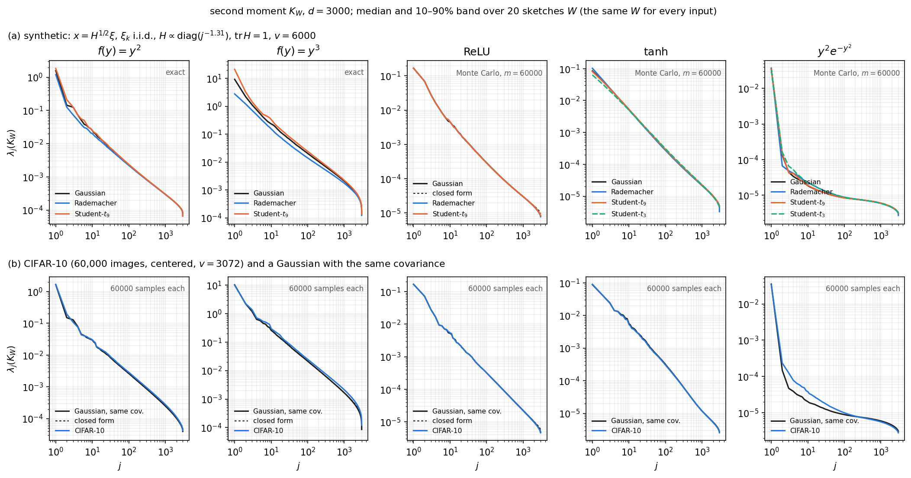
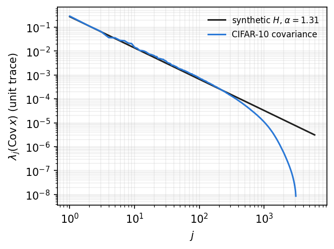

# Other input distributions: how much does the spectrum depend on more than the covariance?

*In the paper: Figure 3 and the paragraph "Universality across data distributions" in Section 2.1.
Code: [`experiments/fig3_universality/`]({{ site.repo_url }}/tree/main/experiments/fig3_universality),
with `plrf/iid.py`, `plrf/inputs.py` and `plrf/montecarlo.py`.*

**Question.** The main theorem assumes Gaussian data. If the input distribution changes but its
covariance does not, does the spectrum of $$K_W$$ change?
{: .lead}

**Answer.** The *decay* does not change, but the constants can. For ReLU, $$\tanh$$ and $$y^2e^{-y^2}$$ the
spectra for different input distributions agree to within 8% beyond the first hundred or so eigenvalues.
For the polynomial activations $$y^2$$ and $$y^3$$, the head of the spectrum depends on the distribution
through its fourth and higher cumulants. Rademacher inputs lower it and Student-$$t$$ inputs raise it;
for $$y^3$$ the factor is 0.3 to 2.3 at $$j = 1$$, and the curves converge only slowly further out. CIFAR-10
behaves like the synthetic inputs, apart from a gap of 17–40% for $$y^3$$ and a raised head for
$$y^2e^{-y^2}$$.
{: .lead}



**Figure 1.** The spectrum of $$K_W$$ ($$d = 3000$$) for several input distributions with the same
covariance, one panel per activation. Each curve is the median over 20 sketches $$W$$ with the 10–90%
band; within each sketch, the same $$W$$ is used for every input. **(a)** Synthetic inputs
$$x = H^{1/2}\xi$$, with $$H \propto \operatorname{diag}(j^{-1.31})$$ ($$\operatorname{tr}H = 1$$, $$v = 6000$$) and
the $$\xi_k$$ i.i.d. and standardized: Gaussian (black), Rademacher (blue), Student-$$t_9$$ (orange), and
Student-$$t_3$$ (green, dashed; only for the bounded activations). For $$y^2$$ and $$y^3$$ every curve is
exact. For the other activations every curve is a Monte Carlo estimate with $$m = 60{,}000$$ samples; the
ReLU panel also shows the exact Gaussian spectrum (dashed), which lies on the estimate. **(b)** CIFAR-10
(all 60,000 images, centered) against a Gaussian with the same covariance, both averaged over 60,000
samples. Dashed: the exact Gaussian spectrum, where a closed form exists.
{: .caption}

## Setup

| | |
|---|---|
| Synthetic data | $$x = H^{1/2}\xi$$, $$H = \operatorname{diag}(j^{-\alpha}) / \sum_k k^{-\alpha}$$, $$\alpha = 1.31$$, $$v = 2d$$; $$\operatorname{Cov}(x) = H$$ for every distribution |
| Coordinates $$\xi_k$$ | i.i.d.: $$N(0,1)$$; Rademacher $$\pm 1$$; Student-$$t_\nu$$ scaled by $$\sqrt{(\nu-2)/\nu}$$ to unit variance, with $$\nu = 9$$ (all activations) and $$\nu = 3$$ (bounded activations only; see below) |
| CIFAR-10 | all 60,000 images (training and test), pixels in $$[0,1]$$, the per-pixel mean subtracted, divided by one global constant so that the average of $$\lvert x\rvert^2$$ is 1; $$v = 3072$$ |
| Gaussian comparison for CIFAR-10 | $$N(0, \Sigma)$$, with $$\Sigma$$ the covariance of the preprocessed images |
| Sketch | $$W$$ with i.i.d. $$N(0,1)$$ entries, $$d = 3000$$ (`paper`) or $$500$$ (`quick`) |
| Activations | $$y^2$$, $$y^3$$, ReLU, $$\tanh$$, $$y^2 e^{-y^2}$$ |
| Matrix | the second moment $$K_W$$; the covariance is stored too |
| Sketches | 20 (`paper`); 3 (`quick`) |
| Seeds | $$W$$ = `default_rng([3, 0, d, draw])` (synthetic) and `default_rng([3, 1, d, draw])` (CIFAR-10); Monte Carlo inputs `default_rng([3, 2, code, d, draw])`, with `code` 0–4 for the distributions (see `run.py`) |

**Why some combinations are missing.** $$K_W$$ for $$f(y) = y^p$$ needs $$\mathbb E\,\xi^{2p} < \infty$$, so
Student-$$t_\nu$$ needs $$\nu > 2p$$: $$t_3$$ is excluded for $$y^2$$ and $$y^3$$. For ReLU, $$K_W$$ exists for
$$t_3$$, but its Monte Carlo estimate has infinite variance (that needs $$\nu > 4$$), so it is excluded too.
The identity activation is left out because $$K_W = W^\top \operatorname{Cov}(x)\, W/d$$ is identical for
every distribution with the same covariance.

**Why the inputs are not Gaussian after projection.** With a power-law $$H$$ and $$\operatorname{tr}H = 1$$,
the effective rank of $$H$$ is about 10. So $$y_i = w_i^\top x$$ is dominated by a few coordinates of $$x$$,
and the central limit theorem does not make it Gaussian: heavy tails and discreteness in $$\xi$$ survive the
projection.

## How each matrix is computed

- **Polynomial activations, synthetic inputs: exactly, for every distribution.** The independent
  coordinates make the joint cumulants of $$(y_i, y_j)$$ explicit, and $$K_W$$ follows from them
  ([Methods](../methods.html#non-gaussian-inputs-with-independent-coordinates)). This also avoids a real
  problem: a Monte Carlo estimate of $$K_W$$ for $$y^3$$ has finite variance only if $$\xi$$ has 12 moments,
  and $$t_9$$ has fewer than 9.
- **ReLU with Gaussian inputs: exactly**, by the arc-cosine kernel.
- **Everything else: Monte Carlo**, with $$m = 20d$$ samples. The Gaussian case is estimated the same way,
  with the same $$m$$, so all the curves in a panel carry the same finite-sample distortion. Where a
  closed form exists for the Gaussian case, the Monte Carlo median is within 2% of it for ReLU and $$y^2$$,
  and within 4% for $$y^3$$ (over $$j \le d/2$$).
- **CIFAR-10:** $$K_W$$ is the average over all 60,000 images, which is exact for the dataset's empirical
  distribution. The Gaussian comparison uses the same number of samples.

## Why the polynomial head depends on the distribution

For $$f(y) = y^p$$, expand $$\mathbb E[y_i^p y_j^p]$$ as a sum over $$2p$$ coordinate indices of $$x$$.

- When the indices pair up into $$p$$ *distinct* coordinates, the expectation is the product of
  variances $$H_{k_1}\cdots H_{k_p}$$. This is the same for every distribution with covariance $$H$$. These
  terms make up the squarefree part of the kernel, which gives the deterministic spectrum of the main
  theorem.
- Terms in which a coordinate repeats involve the fourth and higher cumulants of $$\xi$$. They form the
  other blocks of the [population spectrum](fig2-theorem.html#how-the-population-spectrum-is-computed),
  including the lower Wick components, and at accessible sizes those blocks dominate the head; for $$y^3$$
  that is the linear component.

So the head depends on the distribution, through its cumulants, while deeper in the spectrum the
squarefree part takes over and the curves converge. This is consistent with the main theorem, which
describes the spectrum up to constants. The direction of the change follows the sign of the fourth
cumulant: lower for Rademacher ($$\kappa_4 = -2$$), higher for $$t_9$$ ($$\kappa_4 = 6/5$$).

## Results

Each entry below is the median over sketches of the paired ratio
$$\lambda_j(K_W;\ \text{input})/\lambda_j(K_W;\ \text{Gaussian})$$, computed with the same $$W$$ for both.
$$J^0$$ is the smallest $$J$$ such that this ratio stays in $$[0.8, 1.25]$$ for all $$J \le j \le d/2$$. So
$$J^0 = 1$$ means agreement within 25% everywhere, and a large $$J^0$$ means the head depends on the
distribution.

| activation | input | $$j=1$$ | $$j=10$$ | $$j=100$$ | $$j=1000$$ | $$J^0$$ |
|---|---|---|---|---|---|---|
| $$y^2$$ | Rademacher | 0.76 | 0.83 | 0.95 | 0.99 | 10 |
| $$y^2$$ | Student-$$t_9$$ | 1.16 | 1.00 | 1.01 | 1.00 | 7 |
| $$y^3$$ | Rademacher | 0.30 | 0.67 | 0.69 | 0.84 | 582 |
| $$y^3$$ | Student-$$t_9$$ | 2.29 | 1.42 | 1.18 | 1.08 | 20 |
| ReLU | Rademacher | 1.00 | 1.00 | 1.01 | 0.99 | 1 |
| ReLU | Student-$$t_9$$ | 1.00 | 1.01 | 0.99 | 1.00 | 1 |
| $$\tanh$$ | Rademacher | 1.21 | 0.97 | 0.94 | 0.96 | 1 |
| $$\tanh$$ | Student-$$t_9$$ | 0.95 | 1.00 | 1.01 | 1.01 | 1 |
| $$\tanh$$ | Student-$$t_3$$ | 0.75 | 0.95 | 1.07 | 1.02 | 2 |
| $$y^2e^{-y^2}$$ | Rademacher | 1.05 | 1.21 | 1.04 | 0.98 | 3 |
| $$y^2e^{-y^2}$$ | Student-$$t_9$$ | 0.99 | 1.02 | 1.00 | 1.00 | 1 |
| $$y^2e^{-y^2}$$ | Student-$$t_3$$ | 0.93 | 1.21 | 1.04 | 0.98 | 14 |
| $$y^2$$ | CIFAR-10 | 1.02 | 1.03 | 1.10 | 1.11 | 3 |
| $$y^3$$ | CIFAR-10 | 0.96 | 1.17 | 1.17 | 1.28 | 1501 |
| ReLU | CIFAR-10 | 1.00 | 1.04 | 1.00 | 0.98 | 1 |
| $$\tanh$$ | CIFAR-10 | 1.03 | 0.94 | 0.96 | 0.99 | 1 |
| $$y^2e^{-y^2}$$ | CIFAR-10 | 0.96 | 1.87 | 1.12 | 0.94 | 57 |

From `python -m experiments.fig3_universality.summarize --config paper`, medians over 20 sketches.
{: .caption}

In words:

- **ReLU:** the spectra coincide, within 3% from $$j = 20$$ on and within 8% everywhere.
- **$$\tanh$$ and $$y^2e^{-y^2}$$:** they differ only at the head ($$\tanh$$: $$\lambda_1$$ 21% higher for
  Rademacher and 25% lower for $$t_3$$; $$y^2e^{-y^2}$$: up to a factor 1.55 near $$j = 4$$ for $$t_3$$). From
  $$j = 100$$ on they agree to within 8%. Even $$t_3$$, which has no third moment, changes only the head.
- **$$y^2$$:** within 5% from $$j \approx 120$$ (Rademacher) and $$j \approx 20$$ ($$t_9$$) on.
- **$$y^3$$:** the slowest. At $$j = 1000$$ the ratio is still 0.84 (Rademacher) and 1.08 ($$t_9$$), changing
  monotonically, so fitted local slopes differ slightly at these sizes even though the curves converge.
- **CIFAR-10:** ReLU and $$\tanh$$ agree to within 10%. $$y^2$$ is 6–12% higher from $$j \approx 20$$ on.
  $$y^3$$ is 17% higher at $$j = 10$$–$$100$$, rising to 28% at $$j = 1000$$: a slow change of local slope, about
  0.04 per decade. CIFAR pixels are not independent, so the cumulant argument above does not apply
  directly. $$y^2e^{-y^2}$$ is up to 2.7 times higher at the head ($$j = 3$$) and within 10% from
  $$j \approx 110$$ on.

The covariance of the preprocessed CIFAR-10 images, compared with the synthetic $$H$$: close to
$$j^{-1.31}$$ up to $$j \approx 300$$, falling off fast after that.



**Figure 2.** Eigenvalues of the input covariance (unit trace): the synthetic $$H$$ (black) and CIFAR-10
(blue).
{: .caption}

## Reproduce

```bash
python -m experiments.fig3_universality.run       --config quick    # ~30 s on a laptop (numpy)
python -m experiments.fig3_universality.plot      --config quick
python -m experiments.fig3_universality.run       --config paper    # ~25 min on one GPU (torch, float64)
python -m experiments.fig3_universality.plot      --config paper
python -m experiments.fig3_universality.summarize --config paper    # the table above
```

CIFAR-10 is read from `data/cifar-10-batches-py` (use `--data` to point elsewhere), and downloaded there if
it is missing. `run.py` writes `results/fig3_universality_<config>.npz`, with keys
`<set>__<activation>__<input>__<method>__<K|C>`, each an array of shape (sketches, $$d$$). `plot.py` writes
`figures/fig3_universality_<config>.{pdf,png}` and `figures/fig3_input_spectra_<config>.{pdf,png}`;
`--kind C` plots the covariance instead.
