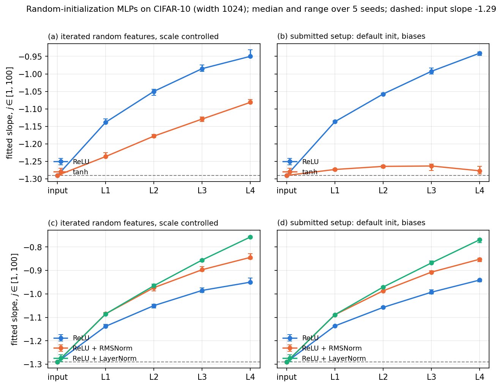
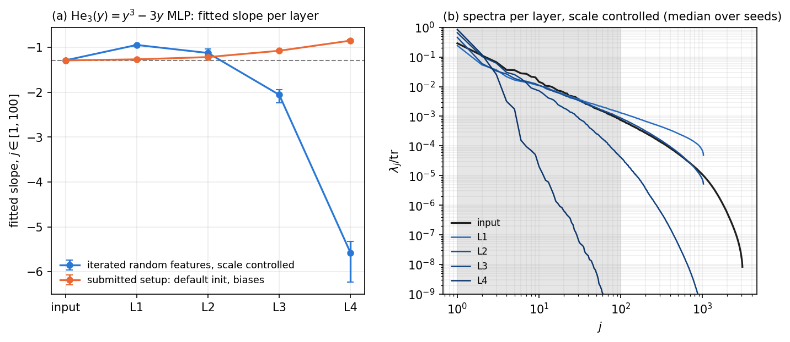
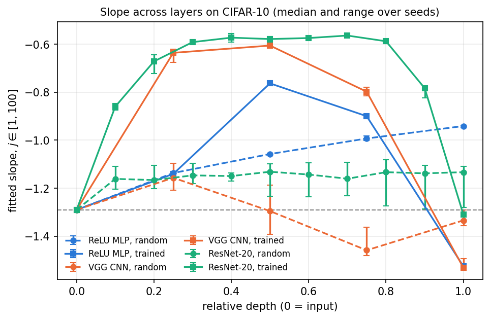
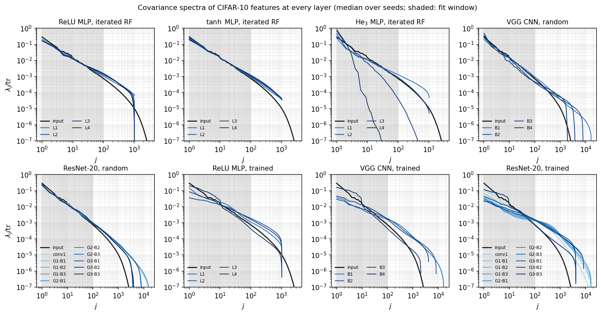
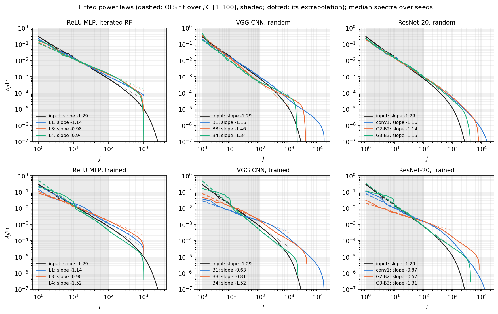

# Depth and training: spectra across the layers of neural networks

*In the paper: supplement Section SM5 ("Power-law persistence across layers"), Table SM1 and its
figures. Code: [`experiments/sm5_depth/`]({{ site.repo_url }}/tree/main/experiments/sm5_depth)
(`nets.py`, `run.py`, `plot.py`, `summarize.py`), with `plrf/fit.py`.*

**Question.** The main theorem is about one random-feature layer applied to power-law data. What happens
to the covariance spectrum of real data (CIFAR-10) as it passes through several layers of a network, at
random initialization and after training?
{: .lead}

**Answer.** These experiments go beyond the theorem, so they are illustrations, not tests of it.
- Every layer of every network has a spectrum close to a power law over the first 100 indices.
- At random initialization, MLPs flatten the exponent layer by layer, and normalization layers flatten
  it faster.
- A random ResNet keeps it nearly fixed.
- Training flattens the middle layers and steepens the last one. The trained ResNet ends close to the
  input's exponent; the trained CNN and MLP end steeper.
- How fast a random MLP drifts depends on the scale of its pre-activations as much as on its activation.
{: .lead}

This is the one experiment that fits exponents, because the theory gives no reference spectrum to
compare with. Every slope is a least-squares fit of $$\log\lambda_j$$ on $$\log j$$ over
$$1 \le j \le 100$$ ([Methods](../methods.html#fitting-exponents)). Each is reported as the median over
seeds with the range, and with its sensitivity to the fit window.

## Setup

| | |
|---|---|
| Data | CIFAR-10. Spectra over the 50,000 training images, with the network in evaluation mode; test accuracy on the 10,000 test images |
| Matrix | the covariance of the features of each layer (flattened for convolutional layers). The sample size $$n = 50{,}000$$ exceeds every feature dimension (at most 16,384), so the whole spectrum is estimated |
| Fit | OLS of $$\log_{10}\lambda_j$$ on $$\log_{10} j$$ over $$1 \le j \le 100$$; robustness windows 10–100, 1–30, 10–300 |
| Random MLPs | depth 4, width 1024; ReLU, $$\tanh$$, $$\mathrm{He}_3(y) = y^3 - 3y$$, and ReLU followed by RMSNorm or LayerNorm; two setups (below); 5 seeds each |
| CNN | VGG-style: four blocks [conv–BN–ReLU, conv–BN–ReLU, max-pool], channels 64–128–256–512; features after each block (dimensions 16384, 8192, 4096, 2048) |
| ResNet-20 | a first convolution, then 3 groups of 3 residual blocks (16, 32, 64 channels); features after the first convolution and after every block |
| Random CNN and ResNet | PyTorch's default initialization; 5 seeds. In evaluation mode at initialization, batch normalization is the identity and the convolutions have no biases, so these networks are positively homogeneous and the weight scale does not affect their spectra |
| Training | ReLU MLP, CNN and ResNet-20: SGD, learning rate 0.1, momentum 0.9, weight decay $$10^{-4}$$, cosine schedule, 50 epochs, batch 256, no augmentation, inputs scaled to $$[-1,1]$$; 3 seeds each |
| Test accuracy | MLP 57.5–58.7%, CNN 87.3–87.7%, ResNet-20 83.6–83.8% |
| Seeds | `torch.manual_seed(seed)` before building each network; training order from `torch.Generator().manual_seed(seed)`; controlled-scale MLP weights from `numpy.random.default_rng([5, seed, layer])`. cuDNN deterministic, TF32 off |

**Two ways to initialize the random MLPs.** The scale of the pre-activations matters for $$\tanh$$ and
$$\mathrm{He}_3$$, and the usual initializations do not control it.

- **Controlled scale (iterated random features).** The input is centered CIFAR-10, divided by one
  constant so that the average of $$\lvert x\rvert^2$$ is 1. Layer $$\ell$$ maps $$h_{\ell-1}$$ to
  $$f(c_\ell W_\ell^\top h_{\ell-1})$$, with $$W_\ell$$ i.i.d. $$N(0,1)$$ and no biases. The constant
  $$c_\ell = (\overline{\lvert h_{\ell-1}\rvert^2})^{-1/2}$$ is fixed once from the data, so every layer's
  pre-activations have mean square 1. Each layer is then the random-feature model of the paper, applied to
  the previous layer's features.
- **PyTorch default initialization.** Inputs are in $$[-1,1]$$, and `nn.Linear` has weights and biases
  uniform on $$\pm1/\sqrt{\text{fan-in}}$$. That gives the weights variance $$1/(3\,\text{fan-in})$$, so the
  pre-activations shrink layer by layer: their root mean square is 0.29, 0.16, 0.09 and 0.055 at layers
  1–4 of the $$\tanh$$ network. At that scale $$\tanh y = y$$ to within 12%, 3.6%, 1.2% and 0.4%, so from the
  second layer on the network is close to linear.

## Random MLPs



**Figure 1.** The fitted slope (window 1–100) of the feature covariance spectrum at each layer of a random
4-layer MLP of width 1024 on CIFAR-10: median over 5 seeds, with bars from the minimum to the maximum
(mostly smaller than the markers). Dashed: the slope of the input covariance, −1.29. Left column:
controlled scale. Right column: PyTorch default initialization. Top row: ReLU and $$\tanh$$. Bottom
row: ReLU without and with normalization after each activation.
{: .caption}

- **ReLU** drifts from −1.29 to −0.95 over four layers, the same in both setups. ReLU is positively
  homogeneous and its biases are small, so the scale does not matter.
- **$$\tanh$$** depends on the setup. With default initialization its slope stays at −1.27 to −1.28, because
  the network is nearly linear. With a controlled scale it drifts steadily, from −1.24 to −1.08: less than
  ReLU, but not zero.
- **Normalization** (RMSNorm or LayerNorm after each activation) flattens the slope faster than ReLU alone:
  −0.84 and −0.76 at layer 4, against −0.95. The results are the same in both setups, since the
  normalization fixes the scale.



**Figure 2.** The random MLP with $$\mathrm{He}_3(y) = y^3 - 3y$$. **(a)** The fitted slope per layer in the
two setups (as in Figure 1). **(b)** With controlled scale, the spectra at each layer and of the input,
divided by their traces (median over seeds; shaded: the fit window).
{: .caption}

$$\mathrm{He}_3$$ is shown separately because, at a controlled scale, it breaks down. At layer 1 it is
already flatter than ReLU (−0.95), because its cubic Hermite component dominates. After that, iterating a
cubic at unit scale gives features with very heavy tails: the 10 largest of the 50,000 images carry 15%
of the covariance's trace at layer 2, 88% at layer 3, and all of it at layer 4. From layer 3 on, the
"spectrum" describes a handful of images, and the fitted slopes (−2.1, −5.6) mean nothing. With default
initialization the scale stays below 0.75, so this does not happen: the slope drifts from −1.27 to −0.85.

## Convolutional networks, residual networks, and training



**Figure 3.** The fitted slope (window 1–100) against relative depth (0 = input, 1 = last recorded layer),
at random initialization (dashed, circles; 5 seeds) and after training (solid, squares; 3 seeds): median
with the range. The ReLU MLP uses default initialization in both cases. Dashed grey: the input slope.
{: .caption}

- **Random ResNet-20:** the slope stays between −1.13 and −1.17 (medians) at every layer, with a
  seed-to-seed range of about $$\pm 0.1$$. **Random CNN:** −1.16, −1.30, −1.46, −1.33 over the four blocks.
- **Trained networks:** all three flatten in the middle (to about −0.6 for the CNN and ResNet, −0.76 for the
  MLP) and steepen at the last layer. The ResNet ends at −1.31, close to the input's −1.29. The CNN and the
  MLP end at −1.53.
- **The 10-class block.** After training, the last layer has about 9 large eigenvalues
  ($$\lambda_9/\lambda_{10} \approx 2.5$$ for the CNN and ResNet; about 1.1 at initialization): the
  10-class structure. Fits that skip it, over 11–100, give: ResNet −1.34 (input −1.31), CNN −1.42, MLP
  −1.46. So the ResNet's agreement with the input is not produced by the class block, and the CNN and MLP
  really are steeper than the input.



**Figure 4.** The covariance spectrum at every layer (light to dark with depth), divided by its trace, and
of the input (black); medians over seeds. Shaded: the fit window.
{: .caption}

Beyond $$j \approx 300$$, the input spectrum falls off fast (CIFAR-10 images have few fine-scale degrees of
freedom), and every network fills that tail in. In the random networks the head is close to the input's
and the tail sits well above it. This is the mechanism of the
[floor for non-polynomial activations](fig2-activations.html#the-floor-of-y2e-y2): the nonlinearity's
higher Hermite degrees spread variance over directions the input barely uses.



**Figure 5.** What a fitted slope summarizes. For each network: the spectra of the input (black) and of
the first, a middle and the last layer, with each fitted power law (dashed over the window $$1 \le j \le 100$$,
shaded; dotted beyond it). The legend gives the slopes.
{: .caption}

The fits describe the window well, but the spectra are not exact power laws. Most bend downward beyond
$$j \approx 300$$, and the trained ones have the class block and other steps near the top. A slope is a
summary of $$1 \le j \le 100$$, nothing more, so it depends on the window:

| last layer | 1–100 | 10–100 | 1–30 | 10–300 |
|---|---|---|---|---|
| input (CIFAR-10) | −1.29 | −1.30 | −1.25 | −1.39 |
| ReLU MLP, controlled | −0.95 | −0.87 | −1.07 | −1.03 |
| $$\tanh$$ MLP, controlled | −1.08 | −1.05 | −1.12 | −1.11 |
| ReLU MLP, default init | −0.94 | −0.88 | −1.04 | −1.08 |
| $$\tanh$$ MLP, default init | −1.28 | −1.32 | −1.23 | −1.69 |
| ReLU + RMSNorm, controlled | −0.84 | −0.82 | −0.89 | −1.01 |
| ReLU + LayerNorm, controlled | −0.76 | −0.69 | −0.85 | −0.73 |
| CNN, random | −1.33 | −1.22 | −1.50 | −0.99 |
| ResNet-20, random | −1.13 | −1.15 | −1.15 | −1.29 |
| MLP, trained | −1.53 | −1.49 | −1.51 | −1.52 |
| CNN, trained | −1.53 | −1.42 | −1.52 | −1.47 |
| ResNet-20, trained | −1.31 | −1.33 | −1.17 | −1.39 |

Medians over seeds. Slopes move by up to 0.4 between windows, so exponents should be compared within one
window, never across windows.
{: .caption}

## Slopes per layer

All slopes over $$1 \le j \le 100$$; median over seeds with [minimum, maximum]; the last column is the
smallest $$R^2$$ over layers and seeds.

| network | L1 / B1 | L2 / B2 | L3 / B3 | L4 / B4 | min $$R^2$$ |
|---|---|---|---|---|---|
| MLP ReLU, controlled | −1.14 [−1.14, −1.13] | −1.05 [−1.06, −1.04] | −0.99 [−0.99, −0.97] | −0.95 [−0.95, −0.93] | 0.989 |
| MLP $$\tanh$$, controlled | −1.24 [−1.24, −1.23] | −1.18 [−1.18, −1.17] | −1.13 [−1.14, −1.12] | −1.08 [−1.08, −1.07] | 0.998 |
| MLP $$\mathrm{He}_3$$, controlled | −0.95 [−0.99, −0.93] | −1.13 [−1.18, −1.03] | (−2.06) | (−5.57) | 0.965 |
| MLP ReLU + RMSNorm, controlled | −1.08 [−1.09, −1.08] | −0.97 [−0.99, −0.97] | −0.90 [−0.90, −0.88] | −0.84 [−0.85, −0.83] | 0.996 |
| MLP ReLU + LayerNorm, controlled | −1.09 [−1.09, −1.08] | −0.97 [−0.97, −0.96] | −0.86 [−0.86, −0.85] | −0.76 [−0.76, −0.75] | 0.991 |
| MLP ReLU, default init | −1.14 [−1.14, −1.13] | −1.06 [−1.06, −1.05] | −0.99 [−1.00, −0.98] | −0.94 [−0.95, −0.94] | 0.993 |
| MLP $$\tanh$$, default init | −1.27 [−1.28, −1.27] | −1.26 [−1.27, −1.26] | −1.26 [−1.28, −1.26] | −1.28 [−1.29, −1.26] | 0.997 |
| MLP $$\mathrm{He}_3$$, default init | −1.27 [−1.27, −1.27] | −1.22 [−1.22, −1.22] | −1.08 [−1.08, −1.06] | −0.85 [−0.86, −0.83] | 0.987 |
| MLP ReLU + RMSNorm, default init | −1.09 [−1.09, −1.09] | −0.99 [−0.99, −0.99] | −0.91 [−0.91, −0.90] | −0.85 [−0.86, −0.85] | 0.997 |
| MLP ReLU + LayerNorm, default init | −1.09 [−1.09, −1.09] | −0.97 [−0.98, −0.97] | −0.87 [−0.87, −0.86] | −0.77 [−0.78, −0.77] | 0.992 |
| MLP ReLU, trained | −1.14 [−1.14, −1.14] | −0.76 [−0.76, −0.76] | −0.90 [−0.91, −0.90] | −1.53 [−1.53, −1.52] | 0.964 |
| CNN, random | −1.16 [−1.21, −1.10] | −1.30 [−1.39, −1.19] | −1.46 [−1.48, −1.36] | −1.33 [−1.36, −1.29] | 0.986 |
| CNN, trained | −0.64 [−0.68, −0.62] | −0.61 [−0.61, −0.60] | −0.80 [−0.81, −0.78] | −1.53 [−1.53, −1.49] | 0.974 |

The $$\mathrm{He}_3$$ values in parentheses are not meaningful (see Figure 2).
{: .caption}

| ResNet-20 | conv1 | G1-B1 | G1-B2 | G1-B3 | G2-B1 | G2-B2 | G2-B3 | G3-B1 | G3-B2 | G3-B3 | min $$R^2$$ |
|---|---|---|---|---|---|---|---|---|---|---|---|
| random | −1.16 | −1.17 | −1.15 | −1.15 | −1.13 | −1.14 | −1.16 | −1.13 | −1.14 | −1.13 | 0.983 |
| trained | −0.86 | −0.67 | −0.59 | −0.57 | −0.58 | −0.57 | −0.56 | −0.59 | −0.78 | −1.31 | 0.885 |

ResNet-20, medians over seeds. The seed-to-seed range is up to $$\pm 0.1$$ (random) and $$\pm 0.05$$ (trained).
The smallest $$R^2$$ of the trained network (0.885) occurs in group 1.
{: .caption}

From `python -m experiments.sm5_depth.summarize --config paper`, which also writes these numbers as the
LaTeX table `figures/sm5_table_paper.tex` (Table SM1).
{: .caption}

## Reproduce

```bash
python -m experiments.sm5_depth.run       --config quick --part all    # ~2 min on a laptop (CPU)
python -m experiments.sm5_depth.plot      --config quick
python -m experiments.sm5_depth.run       --config paper --part all    # ~40 min on one GPU
python -m experiments.sm5_depth.plot      --config paper
python -m experiments.sm5_depth.summarize --config paper               # tables; writes figures/sm5_table_paper.tex
```

`--part mlp|conv|trained` runs one part (about 1 min, 14 min and 21 min on the GPU). Each part writes
`results/sm5_depth_<part>_<config>.npz`, containing every eigenvalue of every layer for every seed (keys
`<network>__<layer>`) and, for `trained`, the training history in the metadata.
