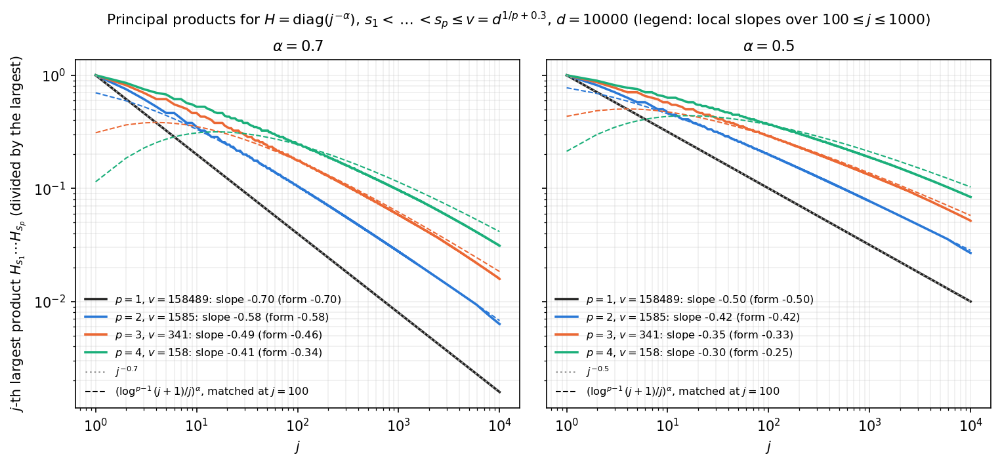
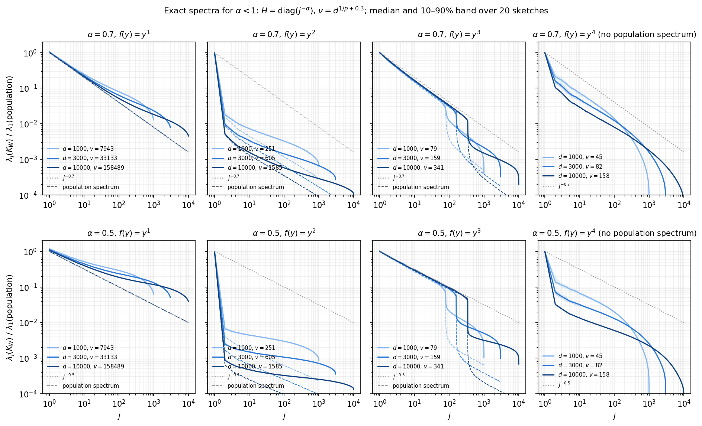
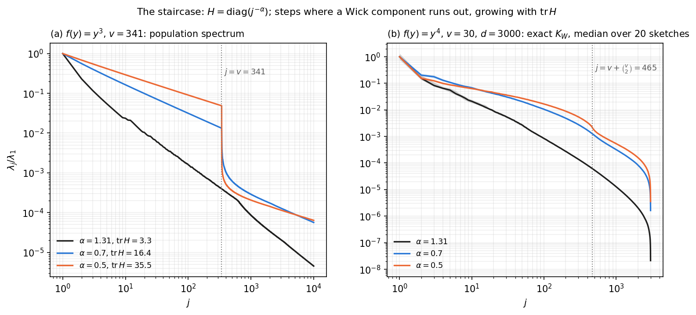

# $$\alpha < 1$$: when the data's tail is not summable

*In the paper: supplement Section SM6 and the paragraph "Scope and limitations". Code:
[`experiments/sm6_alpha/`]({{ site.repo_url }}/tree/main/experiments/sm6_alpha), with `plrf/exact.py`
and `plrf/population.py`.*

**Question.** The main theorem assumes $$\alpha > 1$$, so that $$\operatorname{tr}H = \sum_j H_j$$ stays
bounded however large $$v$$ is. For $$\alpha < 1$$ the trace grows like $$v^{1-\alpha}$$. Is the exponent of
the data still inherited by the random features?
{: .lead}

**Answer.** The numerics are consistent with the exponent being preserved, but a new effect appears: a
*staircase*.
- **Preservation.** The products $$H_{s_1}\cdots H_{s_p}$$, which make up the deterministic spectrum of
  the main theorem, decay like $$(\log^{p-1}(j+1)/j)^\alpha$$ for $$\alpha < 1$$ as well. The exact population
  spectra decay like $$j^{-\alpha}$$ up to such logarithmic corrections.
- **The staircase.** Because $$\operatorname{tr}H$$ grows, the lower-degree Hermite (Wick) components of
  the activation carry weights that grow with $$v$$, and they dominate. Each such component supplies a
  fixed number of eigenvalues (about $$\binom vk$$ for degree $$k$$) and then runs out, so the spectrum
  drops at those indices. These steps are absent for $$\alpha > 1$$ at the same $$v$$. For kernel ridge
  regression, [Wortsman and Loureiro (2025)](https://arxiv.org/abs/2510.04780) prove the operator-level
  version of this staircase. [Below](#the-staircase) it is related to theirs, and the predicted scaling
  of the steps is checked.
- **Finite sketches.** For $$f = y$$ and $$y^2$$, $$K_W$$ approaches its population spectrum only slowly as
  $$d$$ grows.
{: .lead}

## The principal products



**Figure 1.** For $$H = \operatorname{diag}(j^{-\alpha})$$ and $$p = 1, \dots, 4$$: the products
$$H_{s_1}\cdots H_{s_p}$$ over index sets $$s_1 < \dots < s_p \le v$$, in decreasing order, each divided by
its largest value (solid). The index range is $$v = d^{1/p + 0.3}$$ with $$d = 10^4$$, the dimensions used
throughout this page. Dashed: the main theorem's form $$(\log^{p-1}(j+1)/j)^\alpha$$, scaled to agree at
$$j = 100$$. Dotted grey: $$j^{-\alpha}$$. The legend gives the local slopes of both over
$$100 \le j \le 1000$$.
{: .caption}

These products are the spectrum the main theorem compares $$K_W$$ with, up to constants. For $$\alpha < 1$$
they still follow the theorem's form:
- for $$p \le 2$$ the local slopes agree to within 0.01;
- for $$p = 3$$ and $$4$$ the products are slightly steeper (by 0.02–0.07), with the gap closing as $$j$$
  grows.

So their local slope is close to $$-\alpha + \alpha(p-1)/\log j$$, and approaches $$-\alpha$$ only at a
logarithmic rate. The lattice-counting part of the main theorem does not need $$\alpha > 1$$.

## The exact spectra



**Figure 2.** Gaussian data with $$H = \operatorname{diag}(j^{-\alpha})$$ (not normalized), monomial
activations $$f(y) = y^p$$, and $$v = d^{1/p + 0.3}$$. Rows: $$\alpha = 0.7$$ and $$0.5$$. Columns:
$$p = 1, \dots, 4$$.
- Solid: the exact spectrum of $$K_W$$ at $$d = 10^3$$, $$3\cdot10^3$$, $$10^4$$ (light to dark; the legend gives
  $$v$$), as the median over 20 sketches with the 10–90% band.
- Dashed, same color: the population spectrum at the same $$v$$ ($$p \le 3$$), computed with no truncation.
- Each pair is divided by the largest population eigenvalue; for $$p = 4$$, which has no population
  spectrum, by the median $$\lambda_1(K_W)$$.
- Dotted grey: $$j^{-\alpha}$$.
{: .caption}

| $$p$$ | $$\alpha = 0.7$$: $$K_W$$ slope | population slope | $$J_*$$ | $$\alpha = 0.5$$: $$K_W$$ slope | population slope | $$J_*$$ |
|---|---|---|---|---|---|---|
| 1 | −0.56 | −0.70 | 79 | −0.27 | −0.50 | 8 |
| 2 | −0.37 | −0.58 | 17 | −0.13 | −0.41 | 1 |
| 3 | −0.71 | −0.71 | 343 | −0.53 | −0.51 | 341 |
| 4 | −0.56 | — | — | −0.35 | — | — |

At $$d = 10^4$$: fitted slopes over $$10 \le j \le 300$$, and $$J_*$$, the number of leading eigenvalues of
$$K_W$$ within 25% of the population spectrum. The $$p = 2$$ population slope is the theorem's
$$(\log j / j)^\alpha$$: its local slope near $$j = 50$$ is $$-0.52$$ for $$\alpha = 0.7$$ and $$-0.37$$ for $$0.5$$.
{: .caption}

- **$$p = 1$$.** The population spectrum is $$H$$ itself, so the exponent is preserved exactly in the limit.
  At finite $$d$$ the sketch folds the tail of $$H$$ into a floor. By the law of large numbers, the
  coordinates beyond the first $$d$$ contribute about $$\frac1d\big(\sum_{k > d} H_k\big) I$$ to $$K_W$$. For
  $$\alpha > 1$$ this is negligible; for $$\alpha < 1$$ the tail sum grows like $$v^{1-\alpha}$$. So $$K_W$$
  agrees with $$H$$ over a head that grows with $$d$$ (11, 27, 79 eigenvalues at $$\alpha = 0.7$$), and its
  fitted slope approaches $$-\alpha$$ slowly (−0.46, −0.48, −0.56).
- **$$p = 2$$.** The population spectrum has an isolated $$\lambda_1$$ (the mean term, of order
  $$(\operatorname{tr}H)^2$$), then decays like the theorem's $$(\log j/j)^\alpha$$. $$K_W$$ lies above it, for
  the same reason as for $$p = 1$$.
- **$$p = 3$$.** $$K_W$$ follows its population spectrum exactly as far as $$j = v$$, where both drop by a
  large factor. This is the staircase.
- **$$p = 4$$.** The fitted slope changes with $$d$$ (from −0.90 to −0.56 at $$\alpha = 0.7$$). At these sizes
  the visible range mixes several steps of the staircase.

## The staircase



**Figure 3.** The staircase, with $$H = \operatorname{diag}(j^{-\alpha})$$ for $$\alpha = 1.31$$ (black),
$$0.7$$ (blue) and $$0.5$$ (orange). Each spectrum is divided by its largest eigenvalue. **(a)** $$f = y^3$$,
$$v = 341$$: the population spectrum. The legend gives $$\operatorname{tr}H$$. **(b)** $$f = y^4$$, $$v = 30$$,
$$d = 3000$$: the exact spectrum of $$K_W$$, median over 20 sketches with the 10–90% band. Dotted lines:
the indices where a Wick component runs out.
{: .caption}

**Where the steps come from.** Expand the monomial in Wick powers at the scale
$$s = w^\top H w \approx \operatorname{tr} H$$ of the pre-activations, for example

$$
y^3 = {:}y^3{:} + 3s\,{:}y{:}, \qquad y^4 = {:}y^4{:} + 6s\,{:}y^2{:} + 3s^2 .
$$

The component of degree $$k$$ enters $$K_W$$ with weight of order $$s^{p-k} \approx (\operatorname{tr}H)^{p-k}$$.
It contributes eigenvalues of the form (weight) $$\times\, H_{s_1}\cdots H_{s_k}$$, about $$\binom vk$$ of them
(one per index set, plus lower-order terms from repeated indices). For $$\alpha > 1$$ the weights stay
bounded, and the components interleave into one smooth spectrum. For $$\alpha < 1$$ the weights grow with
$$v$$, so the low-degree components lie above everything else. The spectrum then lists all of the
lowest-degree component, drops, lists the next, and so on. The steps sit near
$$j \approx \binom vk$$: at $$j = v$$ for $$y^3$$ (the linear component runs out), and at
$$j = v + \binom v2$$ for $$y^4$$ (the quadratic component runs out). With $$v = d^{1/p+\epsilon}$$, these are
at powers of $$d$$: $$j \approx d^{k(1/p + \epsilon)}/k!$$.

**How large the steps are, and when they persist.** For $$y^3$$ the step at $$j = v$$ separates the last
eigenvalue of the linear component, about $$9(\operatorname{tr}H)^2 H_v$$, from the largest cubic one, about
$$36 H_1H_2H_3$$. With $$\operatorname{tr}H \asymp v^{1-\alpha}$$ and $$H_v = v^{-\alpha}$$, their ratio scales like
$$v^{2-3\alpha}$$. So the step should grow with $$v$$ for $$\alpha < 2/3$$, and fade for $$\alpha > 2/3$$. The exact
population spectrum agrees:

| $$\alpha$$ | $$v = 79$$ | $$v = 159$$ | $$v = 341$$ | $$v = 700$$ | measured growth | predicted $$v^{2-3\alpha}$$ |
|---|---|---|---|---|---|---|
| 0.5 | 10.7 | 14.3 | 20.1 | 28.0 | $$v^{+0.44}$$ | $$v^{+0.50}$$ |
| 0.6 | 4.4 | 4.9 | 5.5 | 6.2 | $$v^{+0.15}$$ | $$v^{+0.20}$$ |
| 2/3 | 2.6 | 2.5 | 2.4 | 2.4 | $$v^{-0.03}$$ | $$v^{0}$$ |
| 0.7 | 2.0 | 1.8 | 1.6 | 1.5 | $$v^{-0.13}$$ | $$v^{-0.10}$$ |
| 0.8 | 1.0 | 1.0 | 1.0 | 1.0 | no step | |
| 1.31 | 1.0 | 1.0 | 1.0 | 1.0 | no step | |

The drop $$\lambda_v / \lambda_{v+1}$$ in the population spectrum of $$y^3$$. The two-eigenvalue heuristic gets
the scaling right but overestimates the constant by about a factor 2, because it ignores the mixing
within the blocks.
{: .caption}

For $$y^4$$ (Figure 3b) the step at $$j = v + \binom v2$$ is a kink rather than a cliff at this size, but
again it is absent for $$\alpha = 1.31$$.

**Relation to Wortsman and Loureiro.** This is the random-feature counterpart of a staircase proved by
[Wortsman and Loureiro (2025)](https://arxiv.org/abs/2510.04780) for kernel ridge regression. They study
inner-product kernels $$h(\langle x, x'\rangle)$$, with $$h$$ a polynomial, on Gaussian data with covariance
$$\sigma_j \propto j^{-\alpha}$$ in dimension $$v$$. For $$\alpha < 1$$ (their Proposition 2), the spectrum of
the kernel operator splits into sectors, one per degree:

- the degree-$$k$$ sector has about $$\binom{v+k}{k}$$ eigenvalues;
- within it, the eigenvalues decay like $$(m - m_k)^{-\alpha}$$, where $$m_k$$ is the sector's starting
  index, with a prefactor that shrinks by a factor of the effective rank $$\operatorname{tr}\Sigma/\sigma_1$$
  from one sector to the next;
- the first few sectors are separated by gaps, how many depending on $$\alpha$$; at $$\alpha = 0$$ they become
  the degree levels of the isotropic case.

Our population operator is of the same type. Writing $$z = H^{1/2} w \sim N(0, H)$$,

$$
\kappa(w, w') = \sum_k k!\, b_k^2\, \big(\lvert z\rvert^2 \lvert z'\rvert^2\big)^{(p-k)/2} \langle z, z'\rangle^k,
$$

an inner-product kernel in $$z$$ up to the norm factors, which concentrate when $$\alpha < 1$$. So the
steps of Figure 3 are their sector boundaries. Their gap between consecutive degrees $$k$$ and $$k+1$$ scales
like $$v^{1 - (k+1)\alpha}$$, the same computation as above. For $$y^3$$, whose components have degrees 1
and 3, the analogous exponent is $$2 - 3\alpha$$. What the random-feature setting adds is the finite sketch:
$$K_W$$ follows these sectors (Figure 2, $$p = 3$$: $$J_* = v$$), so the staircase is visible in the
$$d \times d$$ matrix itself, not only in the operator.

Between the steps, each component decays with the data's exponent: the linear part of $$y^3$$ like
$$H$$ itself, the quadratic part of $$y^4$$ like the products $$H_{s_1}H_{s_2}$$ of Figure 1. This is the
sense in which the exponent is preserved. What the theorem's single formula
$$(\log^{p-1}(j+1)/j)^\alpha$$ no longer captures for $$\alpha < 1$$ is how these pieces are stacked.


## Setup

| | |
|---|---|
| Data | $$x \sim N(0, H)$$, $$H = \operatorname{diag}(j^{-\alpha})_{j \le v}$$, $$\alpha \in \{0.5, 0.7\}$$ (and $$1.31$$ for comparison in Figure 3) |
| Dimensions | $$d \in \{10^3, 3\cdot10^3, 10^4\}$$ (`paper`), $$\{300, 1000\}$$ (`quick`). $$v = \operatorname{round}(d^{1/p + 0.3})$$: the theorem's condition $$v \ge d^{1/p+\epsilon}$$ with $$\epsilon = 0.3$$, from 7943 to 158,489 for $$p = 1$$ and from 45 to 158 for $$p = 4$$ |
| Activations | $$f(y) = y^p$$, $$p = 1, 2, 3, 4$$ |
| Matrix | the exact second moment $$K_W$$ ([Methods](../methods.html#gaussian-inputs-the-hermite-expansion)) |
| References | the population spectrum ($$p \le 3$$), with every coordinate kept explicitly ([how it is computed](fig2-theorem.html#how-the-population-spectrum-is-computed)); the products $$(p!)^2 H_{s_1}\cdots H_{s_p}$$, $$s_1 < \dots < s_p \le v$$, listed in decreasing order without enumerating all of them |
| Sketches | 20 per $$(\alpha, p, d)$$ (`paper`); 3 (`quick`) |
| Seeds | $$W$$ = `numpy.random.default_rng([6, 1, p, d, draw]).standard_normal((v, d))`; Figure 3b: `default_rng([6, 2, ...])` (see `staircase.py`) |

$$H$$ is not normalized, because for $$\alpha < 1$$ the growth of $$\operatorname{tr}H$$ with $$v$$ is the
point. For monomials a normalization would only rescale each spectrum, and the plots divide by a constant
anyway.

## Reproduce

```bash
python -m experiments.sm6_alpha.run       --config quick    # ~1 min on a laptop (numpy)
python -m experiments.sm6_alpha.plot      --config quick
python -m experiments.sm6_alpha.staircase --config quick
python -m experiments.sm6_alpha.run       --config paper    # ~45 min on one GPU; p = 1 at d = 10^4 (v = 158,489) dominates
python -m experiments.sm6_alpha.plot      --config paper    # Figures 1 and 2
python -m experiments.sm6_alpha.staircase --config paper    # Figure 3, ~2 min on a laptop
```

`run.py` writes `results/sm6_alpha_<config>.npz`. It holds `lam_a<alpha>_p<p>_d<d>` (shape (sketches,
$$d$$)), `pop_...` and `principal_...` for the references, and `repro_...` for the reproduction of the
first version's computation (shown on the [revision notes](../revisions.html) page). `staircase.py`
writes `results/sm6_staircase_<config>.npz` and `figures/sm6_staircase_<config>.*`.
