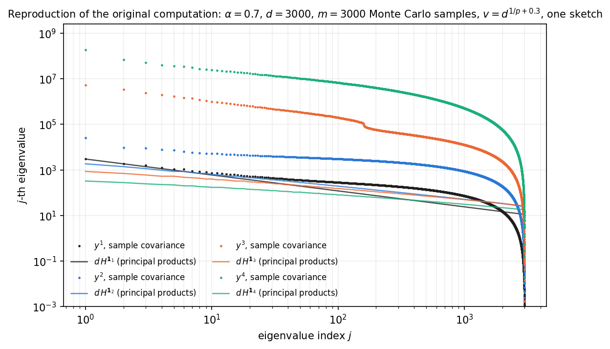

# Revision notes: changes from the first version of the paper

The figures of the first version of the paper were made with earlier code. For the revision every
numerical experiment was rebuilt from scratch, with the code on this site. Reviewing the earlier code
turned up several problems. This page lists them, figure by figure, and says what changed. The experiment
pages themselves describe only the current computations.

## Figure 2 (left): monomial activations

| | First version | Now ([page](experiments/fig2-theorem.html)) |
|---|---|---|
| Matrix | Monte Carlo estimate, with $$m = 10^5$$ samples, of the *covariance* (centered) | the exact second moment $$K_W$$, the object of the theorem (closed form, no Monte Carlo) |
| Text | gave $$m = 10{,}000$$ | — |
| Comparison | a reference line $$j^{-\alpha}$$ | the exact population spectrum of each activation |
| Normalization | each curve divided by its own $$\lambda_1$$, which for even activations is the mean term | divided by the population $$\lambda_1$$, a deterministic constant |
| Activations | $$y^p$$, $$p = 1, \dots, 6$$ | $$y, y^2, y^3$$, plus two polynomials that are not monomials (the population spectrum is implemented for degree $$\le 3$$) |
| Uncertainty | median of 100 trials at one size | median and 10–90% band over 20 sketches, at three values of $$d$$ |

## Figure 2 (right): other activations

| | First version | Now ([page](experiments/fig2-activations.html)) |
|---|---|---|
| Matrix | Monte Carlo covariance, $$m = 10^5$$ | exact $$K_W$$ (closed forms and the Mehler series) |
| Scale | $$H = \operatorname{diag}(j^{-\alpha})$$ not normalized, so pre-activations had mean square about 3.6; not stated | $$\sigma^2 = 1$$, with the earlier $$\sigma^2 = 3.64$$ shown for comparison; stated |
| Sizes | $$v = d = 10^4$$ | $$d \in \{10^3, 3\cdot10^3, 10^4\}$$, which separates what depends on $$d$$ from what does not |
| $$y^2e^{-y^2}$$ | "strong deviation", read as a possible change of exponent | a floor of height $$\propto 1/d$$ from high Hermite degrees, predicted to within 2.5% at $$\sigma^2 = 1$$ |

## Figure 3: input distributions

The earlier figure could not support its conclusion. The most serious problem was that its Student-$$t$$
panel was a second copy of the Gaussian one.

| | First version | Now ([page](experiments/fig3-universality.html)) |
|---|---|---|
| Normalization | every input rescaled to unit norm, $$x \mapsto x/\lvert x\rvert$$. "Gaussian" was then not $$N(0,H)$$, and Rademacher inputs (whose norm is constant) were treated differently from the others | no per-sample normalization; $$\operatorname{tr} H = 1$$ instead |
| Student-$$t$$ | an elliptical multivariate $$t_4$$: one $$\chi^2$$ scale per sample. The unit-norm rescaling cancels that scale exactly, so the panel reproduced the Gaussian one (the spectra agree to 1%) | i.i.d. $$t_\nu$$ coordinates, standardized; $$\nu = 9$$, and $$\nu = 3$$ only for bounded activations |
| CIFAR-10 | pixels not centered, normalized per sample, compared with $$j^{-1.31}$$, although CIFAR-10 has its own spectrum | centered, one global scale, compared with a Gaussian with the same covariance |
| Matrix | Monte Carlo covariance, $$m = 30{,}000$$ | $$K_W$$, exact where a closed form exists (including polynomial activations for every non-Gaussian input), otherwise Monte Carlo with the same $$m$$ for every input |
| Identity activation | shown | omitted: identical for every distribution with the same covariance |
| Uncertainty and seeds | one draw of $$W$$; seeds from Python's `hash()`, which changes between runs | 20 draws, explicit seeds |
| Grey "theory" curve | a heuristic, labelled "zero-free-parameter" | removed; the [population spectrum](experiments/fig2-theorem.html#how-the-population-spectrum-is-computed) is the exact version of what it approximated |
| Conclusion | "remarkably consistent across all four distributions", "strong evidence of universality" | the decay is universal; the head of the spectrum depends on the distribution for polynomial activations and, on CIFAR-10, for $$y^2e^{-y^2}$$ |

## Supplement SM5: depth and training

| | First version | Now ([page](experiments/sm5-depth.html)) |
|---|---|---|
| Samples per covariance | 10,000 training images | all 50,000 (more than every feature dimension) |
| Seeds | none set | explicit seeds for initialization and training order; 5 per random network, 3 per trained network |
| Uncertainty | one network per row | median and range over seeds |
| Fit window | 1–100 in Table SM1, but 10–100 or 2 to the end of the spectrum in four figures; the inconsistent windows caused numerical discrepancies | 1–100 everywhere, with a table of other windows |
| Table SM1 | typed by hand; the trained-MLP row was stale | generated from the results |
| Trained MLP | the text said Adam for 20 epochs; the code used SGD for 50 epochs, without shuffling | SGD for 50 epochs, with shuffling; last-layer slope −1.53 (−1.25 in the earlier run, −1.08 in the table) |
| Random MLPs | PyTorch's default initialization only; it shrinks the pre-activations so much that the $$\tanh$$ network is nearly linear | also a controlled-scale version (iterated random features); the pre-activation scale is reported |
| "$$\tanh$$ preserves the exponent" | yes | an effect of the initialization; at a controlled scale $$\tanh$$ drifts too, though less than ReLU |
| "Training recovers the input exponent" | for the ResNet, and by implication in general | the ResNet's last layer matches the input (−1.31 vs −1.29, robust to the window); the CNN and MLP end steeper (−1.53) |

## Supplement SM6: $$\alpha < 1$$

| | First version | Now ([page](experiments/sm6-alpha.html)) |
|---|---|---|
| Matrix | Monte Carlo sample covariance with $$m = d = 3000$$ samples (the lower half of the spectrum is mostly sampling noise), one sketch | exact $$K_W$$, 20 sketches, three values of $$d$$, $$\alpha \in \{0.5, 0.7\}$$ |
| Reference | the products $$H^{\mathbf 1_p}$$, drawn rescaled next to the spectra | the exact population spectrum ($$p \le 3$$); the products shown separately, against the theorem's form |
| Code | not available | on this site |
| Conclusion | "exponent close to 0.7 … preserved" | consistent with preservation up to logarithmic corrections, plus a new effect, a staircase of steps where each Wick component runs out, which is absent for $$\alpha > 1$$ |

The first version's computation, reproduced (`python -m experiments.sm6_alpha.run`, part `reproduce`):

**Figure.** $$\alpha = 0.7$$, $$d = 3000$$, $$v = d^{1/p + 0.3}$$, one sketch per $$p$$. Points: eigenvalues of
the sample covariance of $$f(W^\top x)$$ over $$m = 3000$$ Monte Carlo samples, not divided by $$d$$.
Lines: $$d$$ times the principal products, unscaled. The points match the original figure, including the
kink of $$y^3$$ near $$j = 160 = v$$, which is the first step of the
[staircase](experiments/sm6-alpha.html#the-staircase). The unscaled products lie below the spectra by a
factor of 14 ($$p = 2$$) to 600,000 ($$p = 4$$), because the lower Wick components dominate. That is why the
original figure's reference lines had to be rescaled to sit near the data.
{: .caption}
